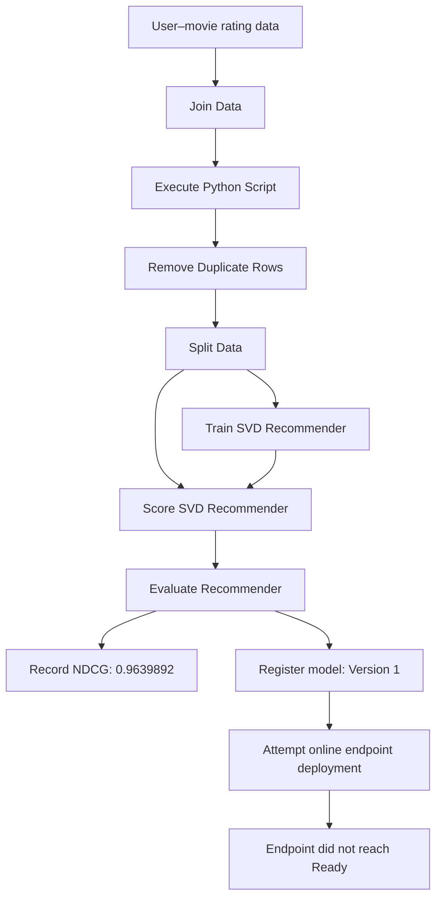

# Movie Recommendation System | Azure Machine Learning

A documented machine-learning project built in **Microsoft Azure Machine Learning Studio / Azure ML Designer**. The pipeline uses a **Singular Value Decomposition (SVD) recommender** to learn patterns from user–movie ratings and produce predicted ratings or recommendation scores.

> **Project format:** This repository is a portfolio showcase built from the project report and screenshots. The supplied PDF does not contain the underlying dataset, runnable notebook/source scripts, or serialized model artifact.

## Project summary

| Item | Recorded project detail |
|---|---|
| Business objective | Build and evaluate a movie recommendation model |
| Recommendation approach | Collaborative filtering with an SVD recommender |
| Azure workflow | Data preparation → split → train → score → evaluate |
| Recorded evaluation metric | **NDCG: 0.9639892** |
| Model registry | Version 1 registered |
| Online deployment | Endpoint did not reach `Ready` and was removed during cleanup |

## Architecture Overview


## Workflow

1. **Prepare data.** The Designer workflow joins related data, runs a Python-script component, and removes duplicate rows.
2. **Split the dataset.** Training and testing subsets are created for model development and evaluation.
3. **Train the recommender.** The SVD Recommender learns patterns across users and movies from the rating data.
4. **Score test records.** The Score SVD Recommender generates predicted ratings or recommendation scores.
5. **Evaluate.** The Evaluate Recommender component measures recommendation quality. The report records an NDCG value of `0.9639892`.
6. **Register the model.** The report records model Version 1 in the Azure ML workspace.
7. **Attempt deployment.** The online endpoint did not reach the Ready state and was subsequently removed during cleanup; the project did not finish with a live recommendation API.

## Selected project evidence

The supplied report documents eight screenshots covering the Azure ML Designer workflow (upper and lower sections), pipeline job history, registered model list, model details, endpoint status, model evaluation, and the NDCG result. These image files are listed in `assets/screenshots/README.md`; upload them from the project ZIP to display them individually here.

**Recorded NDCG: `0.9639892`**

NDCG (Normalized Discounted Cumulative Gain) evaluates how well relevant items are ranked near the top of a recommendation list. The value above is the result recorded in the project report.

## Repository structure

```text
Movie-Recommendation-System/
├── README.md
├── Docs/
│   ├── project_overview.md
│   ├── methodology.md
│   └── evaluation_and_deployment.md
├── assets/
│   └── screenshots/
│       └── README.md
└── reports/
    └── README.md
```

## Report

An Azure Machine Learning Designer project that builds and evaluates a movie recommendation workflow using an SVD collaborative-filtering recommender. The pipeline prepares and splits rating data, trains and scores recommendations, evaluates ranking quality, and registers a model. The project report records the deployment attempt did not reach a Ready endpoint, so it does not claim a live recommendation API.

## Tools and concepts demonstrated

- Microsoft Azure Machine Learning Studio
- Azure ML Designer pipeline composition
- Data joining, Python-script preparation, duplicate removal, and train/test splitting
- SVD collaborative-filtering recommender
- Recommendation scoring and NDCG evaluation
- Azure ML model registration and endpoint deployment workflow
