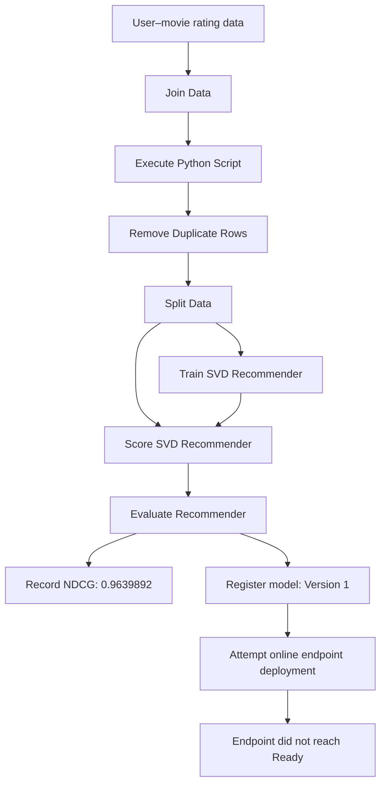

# Movie Recommendation System | Azure Machine Learning

A documented machine-learning project built in **Microsoft Azure Machine Learning Studio / Azure ML Designer**. The pipeline uses a **Singular Value Decomposition (SVD) recommender** to learn patterns from user–movie ratings and produce predicted ratings or recommendation scores.

> **Project format:** This repository is a portfolio showcase built from the project report and screenshots. The supplied PDF does not contain the underlying dataset, runnable notebook/source scripts, or serialized model artifact.

## Project summary

| Item | Recorded project detail |
|---|---|
| Business objective | Build and evaluate a movie recommendation model |
| Recommendation approach | Collaborative filtering with an SVD recommender |
| Azure workflow | Data preparation → split → train → score → evaluate |
| Recorded evaluation metric | **NDCG: 0.9639892** |
| Model registry | Version 1 registered |
| Online deployment | Endpoint did not reach `Ready` and was removed during cleanup |

## High-level architecture



## Workflow

1. **Prepare data.** The Designer workflow joins related data, runs a Python-script component, and removes duplicate rows.
2. **Split the dataset.** Training and testing subsets are created for model development and evaluation.
3. **Train the recommender.** The SVD Recommender learns patterns across users and movies from the rating data.
4. **Score test records.** The Score SVD Recommender generates predicted ratings or recommendation scores.
5. **Evaluate.** The Evaluate Recommender component measures recommendation quality. The report records an NDCG value of `0.9639892`.
6. **Register the model.** The report records model Version 1 in the Azure ML workspace.
7. **Attempt deployment.** The online endpoint did not reach the Ready state and was subsequently removed during cleanup; the project did not finish with a live recommendation API.

## Selected project evidence

### 1. Azure ML Designer workflow

**Upper section — data preparation and initial components**


**Lower section — training, scoring, and evaluation components**


### 2. Pipeline execution and model registration

The report shows the parent pipeline and child jobs as Completed.


### 3. Registered model and deployment status


### 4. Model evaluation

The evaluation job is shown as completed in the report.


**Recorded NDCG: `0.9639892`**


NDCG (Normalized Discounted Cumulative Gain) evaluates how well relevant items are ranked near the top of a recommendation list. The value above is the result recorded in the project report.

## Repository structure

```text
Movie-Recommendation-System/
├── README.md
├── Docs/
│   ├── project_overview.md
│   ├── methodology.md
│   └── evaluation_and_deployment.md
├── assets/
│   └── screenshots/
│       ├── 01-workflow-upper.png
│       ├── 02-workflow-lower.png
│       ├── 03-pipeline-job-history.png
│       ├── 04-registered-model-list.png
│       ├── 05-model-details.png
│       ├── 06-endpoint-status.png
│       ├── 07-model-evaluation.png
│       └── 08-ndcg-metric.png
└── reports/
    └── Movie_Recommendation_System_Documentation.pdf
```

## Report

The complete four-page report, including the original evidence screenshots, is available at [`reports/Movie_Recommendation_System_Documentation.pdf`](reports/Movie_Recommendation_System_Documentation.pdf).

## Tools and concepts demonstrated

- Microsoft Azure Machine Learning Studio
- Azure ML Designer pipeline composition
- Data joining, Python-script preparation, duplicate removal, and train/test splitting
- SVD collaborative-filtering recommender
- Recommendation scoring and NDCG evaluation
- Azure ML model registration and endpoint deployment workflow
